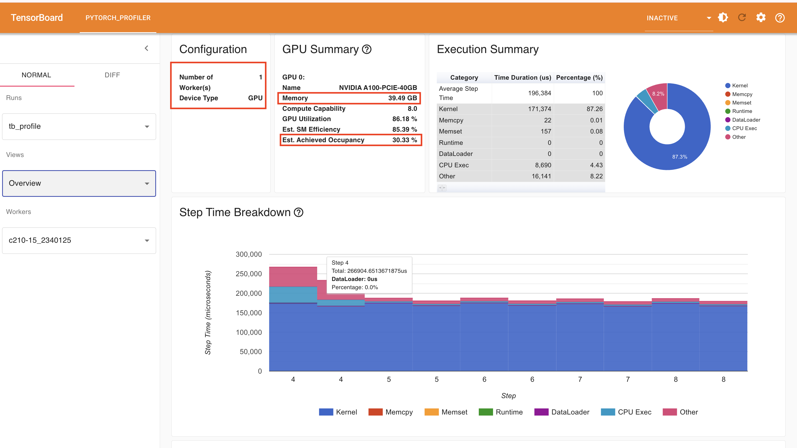
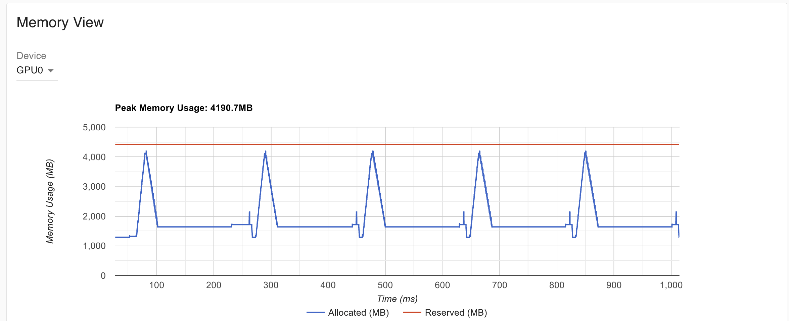
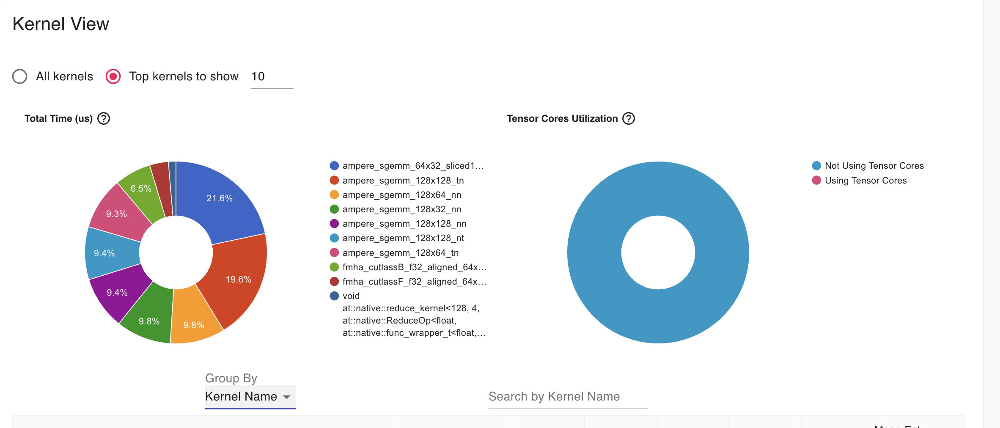
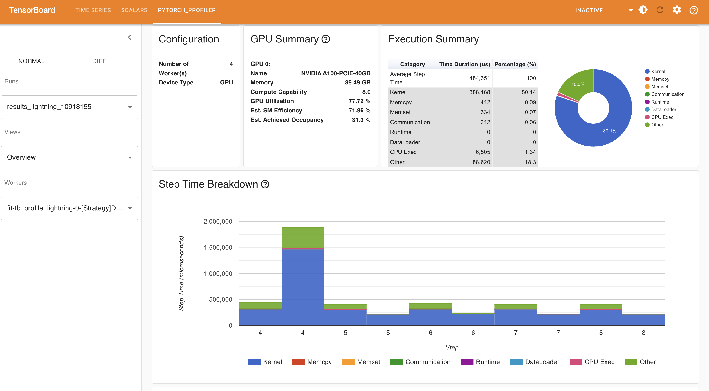
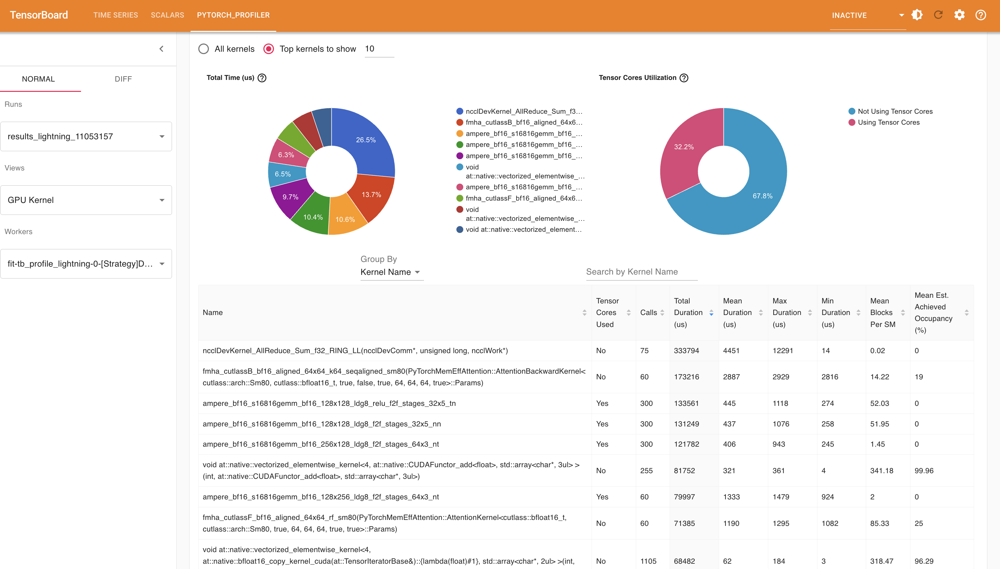
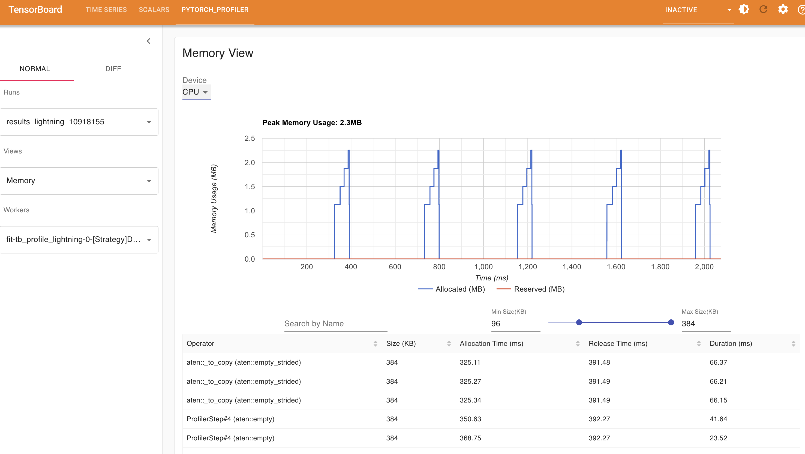
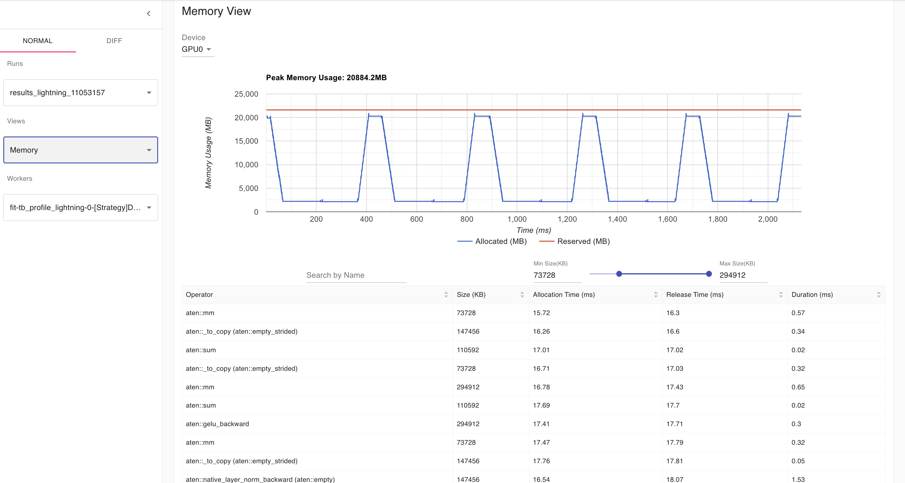
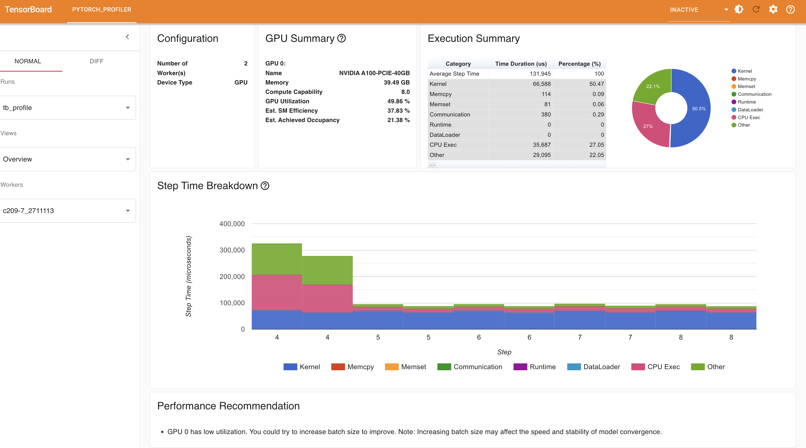

# LabAI-HPCTools
## Index
- [BASELINE - Deliverable 1](#baseline---deliverable-1)
- [DISTRIBUTED - Deliverable 2](#distributed---deliverable-2)

## BASELINE - Deliverable 1
### Key contents
The baseline implementation is obtained from the following repo: https://github.com/huggingface/transformers/tree/main/examples/pytorch/question-answering
### Hugging face repo
#### run_qa.py
This file is in charge of the full training workflow of BERT-uncased model using SQUAD dataset. The script supports different training configurations via several arguments handled by `HfArgumentParser` class. For this purpose 3 python classes are created: 
- `ModelArguments`: Selects the model and tokenizer and defines their configuration.
- `DataTrainingArguments`: configures the training dataset (in this case SQUAD v1.0).
- `TrainingArguments`: Imported from transformers library, required by source repo. 

```python
    parser = HfArgumentParser((ModelArguments, DataTrainingArguments, TrainingArguments))
```
#### 1. Loading dataset and model
This script programs automatically sets up the training with SQUAD dataset directly from the `datasets` library. It also provides support for personal datasets, handled by the alternative if branch.
```python
if data_args.dataset_name is not None:
        # Downloading and loading a dataset from the hub.
        raw_datasets = load_dataset(
            data_args.dataset_name,
            data_args.dataset_config_name,
            cache_dir=model_args.cache_dir,
            token=model_args.token,
            trust_remote_code=model_args.trust_remote_code,
        )
```
Regarding the model, config extracts the previous loaded arguments before the model and tokenizer are instantiated:
```python
config = AutoConfig.from_pretrained(
        model_args.config_name if model_args.config_name else model_args.model_name_or_path,
        cache_dir=model_args.cache_dir,
        revision=model_args.model_revision,
        token=model_args.token,
        trust_remote_code=model_args.trust_remote_code,
    )
    tokenizer = AutoTokenizer.from_pretrained(
        model_args.tokenizer_name if model_args.tokenizer_name else model_args.model_name_or_path,
        cache_dir=model_args.cache_dir,
        use_fast=True,
        revision=model_args.model_revision,
        token=model_args.token,
        trust_remote_code=model_args.trust_remote_code,
    )
    model = AutoModelForQuestionAnswering.from_pretrained(
        model_args.model_name_or_path,
        from_tf=bool(".ckpt" in model_args.model_name_or_path),
        config=config,
        cache_dir=model_args.cache_dir,
        revision=model_args.model_revision,
        token=model_args.token,
        trust_remote_code=model_args.trust_remote_code,
    )
```
#### 2. Preprocessing
In this stage, the script transforms the questions and paragraphs in BERT-format. The function `def prepare_train_features(examples)` is in charge of that.

#### 3. Training and evaluation
We use `QuestionAnsweringTrainer`, an adaptation of `Trainer` class of `transformers` library, customized by HuggingFace in this repo (`trainer_qa.py` file).
`trainer.train()` executes the training with the hardware resources allocated by the job `run_baseline.sh`.
```python
    # Initialize our Trainer
    trainer = QuestionAnsweringTrainer(
        model=model,
        args=training_args,
        train_dataset=train_dataset if training_args.do_train else None,
        eval_dataset=eval_dataset if training_args.do_eval else None,
        eval_examples=eval_examples if training_args.do_eval else None,
        processing_class=tokenizer,
        data_collator=data_collator,
        post_process_function=post_processing_function,
        compute_metrics=compute_metrics,
    )

    # Training
    if training_args.do_train:
        checkpoint = None
        if training_args.resume_from_checkpoint is not None:
            checkpoint = training_args.resume_from_checkpoint
        train_result = trainer.train(resume_from_checkpoint=checkpoint) <- TRAINING STARTS
        trainer.save_model()  # Saves the tokenizer too for easy upload

        metrics = train_result.metrics
        max_train_samples = (
            data_args.max_train_samples if data_args.max_train_samples is not None else len(train_dataset)
        )
        metrics["train_samples"] = min(max_train_samples, len(train_dataset))

        trainer.log_metrics("train", metrics)
        trainer.save_metrics("train", metrics)
        trainer.save_state()
```
Finally, the model evaluates its performance on the validation dataset with `trainer.evaluate()`.
```python
# Evaluation
    if training_args.do_eval:
        logger.info("*** Evaluate ***")
        metrics = trainer.evaluate()

        max_eval_samples = data_args.max_eval_samples if data_args.max_eval_samples is not None else len(eval_dataset)
        metrics["eval_samples"] = min(max_eval_samples, len(eval_dataset))

        trainer.log_metrics("eval", metrics)
        trainer.save_metrics("eval", metrics)
```
The remainder of the file handles the post-processing of the predictions.

#### trainer_qa.py
A provided repository script containing `QuestionAnsweringTrainer`, a specialized subclass of transformers library 's `Trainer` for Question-Answering tasks. It overrides the `evaluate()` and `predict()` function to allow metric computation on processed text.

#### utils_qa.py
Another provided repository script containing post-processing functions needed by the `QuestionAnsweringTrainer`. Its main objective is to post-process the model's predictions and convert them to answers that are substrings of the original text.

### SLURM jobs
These are the jobs executed into Finisterrae 3. The first one is the baseline training job(`run_baseline.sh`), responsible of activating the Python environment and install dependencies needed from Hugging face repository (found in `requirements.txt`). Finally, a code profiling job (`run_profiling.sh`) was created and executed with tensorboard.

#### run_baseline.sh
The training is executed with the following hyperparameters: a batch size of 12 examples, learning rate 3x10^-5 for the Adam optimizer (default optimizer used when no specific one is passed), 2 epochs, and  a maximum 384 token length that BERT can processed at the same time. If 384 tokens are exceeded , they are split using a document stride of 128 tokens.
```python
perf stat python run_qa.py \
  --model_name_or_path google-bert/bert-base-uncased \
  --dataset_name rajpurkar/squad \
  --do_train \
  --do_eval \
  --per_device_train_batch_size 12 \
  --learning_rate 3e-5 \
  --num_train_epochs 2 \
  --max_seq_length 384 \
  --doc_stride 128 \
  --output_dir /tmp/debug_squad/
```

#### run_profiling.sh
This job is similar to the baseline, except for the number of epochs and the size of the dataset. We restrict the dataset to 1000 examples and run only 1 epoch to make a profiling, to avoid using unnecessary resources while still capturing overall perfomance metrics. In addition, metrics are saved into the TensorBoard data folder every 50 steps.
```python
perf stat python run_qa.py \
  --model_name_or_path google-bert/bert-base-uncased \
  --dataset_name rajpurkar/squad \
  --do_train \
  --do_eval \
  --per_device_train_batch_size 12 \
  --learning_rate 3e-5 \
  --num_train_epochs 1 \
  --max_seq_length 384 \
  --max_train_samples 1000 \
  --doc_stride 128 \
  --output_dir ./profiling_v3/ \
  --report_to none \
  --logging_steps 10 \
  --eval_strategy steps \
  --eval_steps 50 \
```
We also added the Pytorch profiler to the `run_qa.py` file:
```python
import torch
from torch.profiler import profile, ProfilerActivity, schedule, tensorboard_trace_handler

class ProfilerCallback(TrainerCallback):
    def __init__(self, profiler):
        self.profiler = profiler

    def on_step_end(self, args, state, control, **kwargs):
        self.profiler.step()

[...]

    if training_args.do_train:
        checkpoint = None
        if training_args.resume_from_checkpoint is not None:
            checkpoint = training_args.resume_from_checkpoint
        # Profiler config
        prof = profile(
            activities=[ProfilerActivity.CPU, ProfilerActivity.CUDA],
            schedule=schedule(wait=2, warmup=2, active=5, repeat=1),
            on_trace_ready=tensorboard_trace_handler(training_args.output_dir + "/tb_profile"),
            record_shapes=True,
            profile_memory=True,
            with_stack=False
        )
        
        prof.start()
        trainer.add_callback(ProfilerCallback(prof))
        
        train_result = trainer.train(resume_from_checkpoint=checkpoint)
        
        prof.stop()
```

### Reporting training times
Training setup:
- Hardware: 1 node, 32 cores, 64 GB of mem and 1 GPU NVIDIA A100
- Software: `run_qa.py`
- Model and dataset: BERT uncased and SQUAD v1.0
- Hyperparameters: 
    - Batch size: 12
    - Epochs: 2
    - Learning rate: 3e-5
    - Max sequence length: 384
    - Doc. stride = 128

#### Sequential times
| | Time (min) | Samples/s | achieved TFLOP/s | training loss |
| :--- | :--- | :--- | :--- | :--- |
| *Training* | 49:06.61 | 60.063 | 10.96 | 0.9787 |
| *Evaluation* | 1:03.46 | 169.42 | | |

With `perf stat`, the following metrics are obtained:
```
        3028674.07 msec task-clock:u              #    0.985 CPUs utilized          
                 0      context-switches:u        #    0.000 K/sec                  
                 0      cpu-migrations:u          #    0.000 K/sec                  
           1505223      page-faults:u             #    0.497 K/sec                  
     8357903391414      cycles:u                  #    2.760 GHz                    
    22065735623424      instructions:u            #    2.64  insn per cycle         
     4203951612527      branches:u                # 1388.050 M/sec                  
        3894672210      branch-misses:u           #    0.09% of all branches        

    3073.851744782 seconds time elapsed

    2995.507597000 seconds user
      25.054931000 seconds sys
```
Although 32 CPU cores were requested in the SLURM job, only 0.985 CPUs are utilized in avarage. This means that GPU is idle most of the time, which is highly innefficient. This underutilization is confirmed by the elapsed time. One of the main reasons is the small batch size (12), which fails to exploit the A100 computational power. Another bottle neck is that only one process is in charge of loading the data (`dataloader_num_workers=0` in the `run_qa.py`log script).

### Profiling
Tensorboard is also used for hardware profiling. For this analysis, a smaller training is executed: 1 epoch and 1000 examples.

The overview confirms the bottle necks identified earlier:
- Only one worker is used
- The underutilization of GPU memory


The Memory view shows a peak utilization of 4190.7MB, wasting the 246GB available on a A100 node.


This graphic shows Tensor cores are not being utilized because FP32 is used instead of FP16 ((`fp16=False`)). This should be change to actually activate the hardware acceleration and increase the TFLOPS/s.


### Conclusions
The combined analysis of executions times, `perf stat`'s output and Tensorboard profile view corroborates the performance bottlenecks present in the baseline.
There are three main critical issues:
-  GPU Memory underutilization: The configured 12 batch size is insufficient for NVIDIA A100. So the solution must be increase the batch size as much as GPU's RAM allow us in order to process more samples.
- Sequential operation. Despite requesting 32 cores the training is executed sequentially. This forces GPU to constantly wait for CPU. We must enable parallelism by setting dataloader_num_workers with `run_qa.py` arguments to a higher value. Or maybe reduce the cores allocation to avoid asking for more hardware than neccesary.
- Tensor cores unused: FP32 is used so the kernel is not utilizing GPU's tensor cores. FP16 must be implmented to activate this specialized hardware and exploit it.

## DISTRIBUTED - Deliverable 2
For this deliverable, two distributed training implementations have been developed: one utilizing PyTorch Lightning and the other employing Accelerate. Both approaches leverage Distributed Data Parallel (DDP). Given that the model's memory allows it to fit entirely within a single GPU, the training process is being executed across two GPUs located on a single supercomputing node. By referencing the execution times of the sequential baseline [see sequential execution times](#sequential-times), the following performance metrics have been derived for each implementation (e.g., execution time, speedup, and efficiency measures).

### Lightning
The experiments were conducted on a single computing node equipped with two NVIDIA A100 GPUs and 64 GB of RAM. For the distributed training, PyTorch Lightning was utilized to fine-tune the pre-trained BERT-base-uncased model on the SQuAD dataset. The training phase was executed for two epochs with a per-device batch size of 128, yielding an effective batch size of 256. The optimization process employed a learning rate of 6.399e-4 (it was proportionally scaled by the same factor applied to the batch size, relative to the baseline configuration) and included 100 warmup steps. The maximum sequence length was restricted to 384 tokens with a document stride of 128. To optimize data throughput, the data loaders were configured with 4 workers and pinned memory enabled.
````
srun python -u run_qa_lightning.py \
  --model_name_or_path google-bert/bert-base-uncased \
  --dataset_name rajpurkar/squad \
  --do_train \
  --do_eval \
  --per_device_train_batch_size 128 \
  --dataloader_num_workers 4 \
  --learning_rate 6.399e-4 \
  --warmup_steps 100 \
  --dataloader_pin_memory True \
  --num_train_epochs 2 \
  --max_seq_length 384 \
  --doc_stride 128 \
  --output_dir $STORE/hpctools/results_lightning_$SLURM_JOB_ID
````
To comprehensively profile the implementation, both the PyTorch Profiler and the nvidia-smi utility were utilized, with the latter logging hardware metrics directly to a CSV file. 
```
nvidia-smi --query-gpu=timestamp,index,name,utilization.gpu,memory.used,memory.total --format=csv -l 5 > gpu_usage_light.csv &
```
```python
profiler = PyTorchProfiler(
        dirpath=training_args.output_dir,
        filename="tb_profile_lightning",
        schedule=schedule(wait=2, warmup=2, active=5, repeat=1),
        activities=[ProfilerActivity.CPU, ProfilerActivity.CUDA],
        record_shapes=True,
        profile_memory=True,
        with_stack=False
    )
```
#### Implementation
To enable the distributed training implementation, the original QA class was entirely refactored into a PyTorch Lightning module (trainer_qa_lightning.py), incorporating the following methods:
````python
class QALightning(pl.LightningModule):
    def __init__(self, model):
        super().__init__()
        self.model = model

    def training_step(self, train_batch, batch_idx):
        outputs = self.model(**train_batch)
        loss = outputs.loss
        self.log("train_loss", loss)
        return loss

    def forward(self, batch):
        return self.model(**batch)

    def configure_optimizers(self):
        no_decay = ["bias", "LayerNorm.weight"]
        
        optimizer_grouped_parameters = [
            {
                "params": [
                    p for n, p in self.model.named_parameters() 
                    if not any(nd in n for nd in no_decay)
                ],
                "weight_decay": 0.01,
            },
            {
                "params": [
                    p for n, p in self.model.named_parameters() 
                    if any(nd in n for nd in no_decay)
                ],
                "weight_decay": 0.0,
            },
        ]
        optimizer = torch.optim.AdamW(optimizer_grouped_parameters, lr=3e-5)
        return optimizer

    def validation_step(self, val_batch, batch_idx):
        outputs = self.model(**val_batch)

        if outputs.loss is not None:
            loss = outputs.loss
            self.log("val_loss", loss, sync_dist=True)

        labels_start = val_batch.get("start_positions")
        labels_end = val_batch.get("end_positions")

        if labels_start is not None and labels_end is not None:
            preds_start = torch.argmax(outputs.start_logits, dim=1)
            preds_end = torch.argmax(outputs.end_logits, dim=1)
            
            exact_match = ((preds_start == val_batch["start_positions"]) & 
                        (preds_end == val_batch["end_positions"])).float().mean()
            
            self.log("val_em", exact_match, sync_dist=True)

        return outputs.loss
````
Several versions of the new model exhibited overfitting, characterized by an initial decrease in the loss followed by a subsequent increase after a few steps. To mitigate this issue, the optimizer configuration was modified to apply regularization (weight decay) to the model parameters, specifically excluding biases and layer weights from this regularization.

It was also required to integrate two specific callbacks into the training phase: PerformanceMonitorLightning and an early stopping mechanism (early_stop_callback). The former was designed to discard the initial training steps by treating them as a warmup phase, while the latter was implemented to mitigate the overfitting issues observed in previous iterations.
`````python
class PerformanceMonitorLightning(Callback):
    def __init__(self, warmup_steps=50):
        self.warmup_steps = warmup_steps
        self.start_time = None
        self.total_samples_after_warmup = 0

    def on_train_batch_end(self, trainer, pl_module, outputs, batch, batch_idx):
        if trainer.global_step == self.warmup_steps:
            trainer.strategy.barrier("warmup_sync")
            self.start_time = time.time()
            
        if trainer.global_step > self.warmup_steps:
            local_batch_size = len(batch["input_ids"])
            self.total_samples_after_warmup += local_batch_size * trainer.world_size

    def on_train_end(self, trainer, pl_module):
        if self.start_time is not None:
            trainer.strategy.barrier("end_sync")
            total_time = time.time() - self.start_time
            
            samples_per_second_total = self.total_samples_after_warmup / total_time
            samples_per_second_per_gpu = samples_per_second_total / trainer.world_size

            if trainer.is_global_zero:
                print("\n--- PERFORMANCE METRICS (LIGHTNING) ---")
                print(f"Used GPUs (World Size): {trainer.world_size}")
                print(f"Total processed samples (excluding warmup): {self.total_samples_after_warmup}")
                print(f"Measured time (s): {total_time:.2f}")
                print(f"Total samples/s: {samples_per_second_total:.2f}")
                print(f"Samples/s/GPU: {samples_per_second_per_gpu:.2f}")
                
                if "train_loss" in trainer.callback_metrics:
                    print(f"Final Loss: {trainer.callback_metrics['train_loss']:.4f}")
                print("---------------------------------------\n")
`````
````
    early_stop_callback = EarlyStopping(
        monitor='val_loss',
        min_delta = 0.00,
        patience=3,
        verbose=True,
        mode='min',
    )
````
#### Performance Metrics
| Phase | GPUs | Time (min) | Samples/s | Samples/GPU | GFLOPS | Speedup | efficiency (MFU) (%) | final loss |
| :--- | :--- | :--- | :--- | :--- | :--- | :--- | :--- | :--- |
| Training | 2 | 8:20.34 | 328.14 | 164.07 | - | 5.89x | - | 0.8994 |
| Evaluation | 2 | - | - | - | - | - | - | - |

In terms of execution time, a speedup of 5.89x was achieved. This significant performance gain is attributable not solely to the increased GPU count and the implementation of the DDP strategy, but also to the activation of bf16 mixed precision, which facilitates Tensor Core utilization. Consequently, the processing throughput, measured in samples per second, experienced a nearly fivefold increase.

#### Profiling results
The TensorBoard profiling reveals an execution dominated by kernel computation, demonstrating a significantly improved step time compared to the baseline. 



Enabling bf16 mixed precision activates Tensor Core utilization, reaching 31.7%, a stark contrast to the previous complete lack of utilization of this hardware feature. Furthermore, the Memory View confirms that the CPU is effectively offloading computationally expensive tasks to the GPUs.








However, peak memory consumption reaches only 20,884.2 MB (20.88 GB) out of the 40 GB capacity available on the Finisterrae 3 GPUs.

Consequently, while execution times and overall performance have substantially improved, GPU memory utilization could be further maximized by increasing the batch size. Nevertheless, this adjustment introduces the risk of exceeding GPU memory limits (Out-Of-Memory errors), which would necessitate the adoption of alternative distributed training paradigms beyond DDP, such as Fully Sharded Data Parallel (FSDP).

### Accelerate
#### Experimental setup
The experimental setup utilized one compute node configured for two concurrent processes, allocating two NVIDIA A100 GPUs managed by Hugging Face Accelerate with the PyTorch Distributed Data Parallel (DDP) backend. Training was executed in Bfloat16 (bf16) mixed precision to accelerate Tensor Core computations, using these launch parameters:
````
accelerate launch \
  --multi_gpu \
  --num_processes 2 \
  --num_machines 1 \
  --mixed_precision bf16 \
  --dynamo_backend no \
  run_qa.py \
  --model_name_or_path google-bert/bert-base-uncased \
  --dataset_name rajpurkar/squad \
  --do_train \
  --do_eval \
  --bf16 \
  --per_device_train_batch_size 16 \
  --dataloader_num_workers 4 \
  --learning_rate 5e-5 \
  --warmup_steps 500 \
  --weight_decay 0.01 \
  --dataloader_pin_memory True \
  --num_train_epochs 2 \
  --max_seq_length 384 \
  --doc_stride 128 \
  --max_grad_norm 1.0 \
  --logging_steps 50 \
  --output_dir $STORE/hpctools/results_acc_2gpus_$SLURM_JOB_ID
````
To comprehensively profile the implementation, both the PyTorch Profiler and the nvidia-smi utility were utilized again, with the latter logging hardware metrics directly to a CSV file. 
```
nvidia-smi --query-gpu=timestamp,index,name,utilization.gpu,memory.used,memory.total --format=csv -l 5 > gpu_usage_acc.csv &
```
````python
# Profiler config
        prof = profile(
            activities=[ProfilerActivity.CPU, ProfilerActivity.CUDA],
            schedule=schedule(wait=2, warmup=2, active=5, repeat=1),
            on_trace_ready=tensorboard_trace_handler(training_args.output_dir + "/tb_profile"),
            record_shapes=True,
            profile_memory=True,
            with_stack=False
        )
````
#### Implementation
To optimize data throughput, the number of dataloader workers was increased to 4, and the batch size was scaled up to 16 to maximize GPU memory utilization. Consequently, in accordance with the batch size increase from 12 to 16 (batch in total), the learning rate was proportionally adjusted by the same factor, scaling from 3e-5 to 5e-5. 

During the fine-tuning, for a fixed duration of two epochs, an initial degradation in the training loss (train_loss) was observed when scaling up the batch size. This behavior stem from the inherent structural trade-off between effective batch size and weight update frequency. Specifically, increasing the batch size intrinsically reduces the total number of optimization steps per epoch. Consequently, experiments utilizing an effective batch size of 128 (64 per GPU) yielded a training loss of 1.4286, which was substantially higher than the baseline value of 0.9787. Furthermore, attempting to compensate for this by scaling the learning rate introduced convergence instability within the AdamW optimizer. Therefore, a batch size of 16 was ultimately selected, as it provided the optimal equilibrium between computational throughput (HPC performance) and task-specific evaluation metrics, namely F1 score and Exact Match (EM) from a machine learning point of view.

This implementation natively supports both Accelerate and distributed training paradigms by inheriting directly from the Hugging Face Trainer class. It effectively leverages internal properties such as world_size for global batch size calculations, as well as the should_save and should_log flags to prevent race conditions and inter-process conflicts. Consequently, this architecture ensures seamless compatibility and can be executed directly via the accelerate launch command.

####  Performance Metrics
| Phase | GPUs | Time (min) | Samples/s | Samples/GPU | GFLOPS | Speedup | efficiency (MFU) (%) | final loss |
| :--- | :--- | :--- | :--- | :--- | :--- | :--- | :--- | :--- |
| Training | 2 |10:31.89 | 280.084 | 140.042 | 32309300 | 4,66x| 8.19 | 1.1081 |
| Evaluation | 2 | 00:10.52 | 1021.721 | 510,8605 | - | 6,03x | - | - |

For this implementation, execution time improvements were similarly driven by the factors identified in the Lightning setup, namely the increased batch size and the activation of bf16 mixed precision. However, a Model Flops Utilization (MFU) below 10% indicates that the code remains suboptimal in terms of hardware efficiency. Target values typically range between 20% and 40%—as addressed during coursework—or even exceed 40% in highly optimized distributed environments.

#### Profiling results


The profiling analysis indicates that GPU utilization remains low with this current batch size configuration, operating at 49.86% capacity with a multiprocessor efficiency of 37.83%. CPU execution (CPU Exec) accounts for 27.05% of the total runtime, pointing to a bottleneck where the GPU experiences idle time while awaiting CPU task processing. In fact, the profiler itself explicitly recommends increasing the batch size, a modification that was ultimately constrained due to the aforementioned training loss degradation.

### Comparing Lightning and Accelerator
- PyTorch Lightning: Demonstrates significantly higher execution speed, achieving nearly a 20% increase in sample throughput (samples/sec). By accommodating a substantially larger per-GPU batch size (128), GPU memory saturation is optimized. Furthermore, the framework successfully mitigated the initial overfitting through weight decay regularization and an early stopping mechanism. This enabled the deployment of a large batch size (128) while preserving strong convergence stability and achieving an optimal final loss of 0.8994.

- Accelerate: Exhibits a pronounced CPU-bound bottleneck, with CPU execution accounting for 27.05% of the total runtime. Consequently, the GPU suffers from extensive idle time awaiting data, leading to low multiprocessor efficiency (37.83%) and a suboptimal Model FLOPs Utilization (MFU) of 8.19%. Moreover, attempting to scale the batch size to 128 to maximize GPU saturation exposed a sharp trade-off between computational throughput and model accuracy: training loss degraded significantly to 1.4286, and scaling the learning rate induced instability within the optimizer. To preserve task performance (F1 score and Exact Match), computational efficiency was intentionally compromised by reducing the batch size to 16, ultimately resulting in a higher final loss (1.1081) compared to Lightning.

### Conclusion

In conclusion, PyTorch Lightning delivers superior computational performance and model optimization at the cost of requiring a substantial code refactoring into its high-level abstractions. Conversely, Accelerate provides a low-friction, native integration path; however, it remains severely constrained by convergence instabilities when scaling the batch size, leading to hardware underutilization and significant CPU bottlenecks.

To address the limitations observed in the Accelerate implementation, a viable optimization strategy would be to further refine the hyperparameter schedule—specifically tuning the learning rate and warmup steps—to stabilize training at higher batch sizes. Should convergence issues persist despite these adjustments, transitioning to an alternative optimization algorithm (such as LARS or LAMB, which are explicitly designed for large-batch regime stability) would represent the next logical step."
